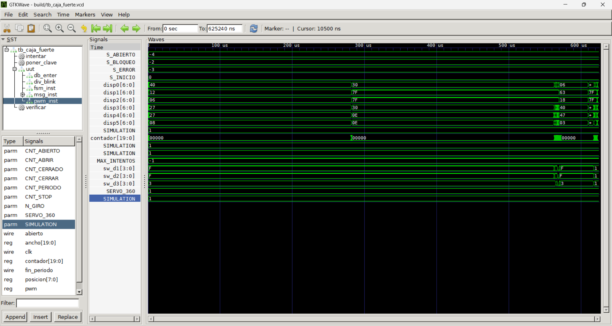

# Informe de Laboratorio: Caja Fuerte Digital con Cerradura Servo-Controlada mediante Máquinas de Estados Finitos (FSM) en Verilog

## Integrantes
- [Andres Mateo Arias Aguilera](https://github.com/mateoaeora124)
- [Gabriel Cangrejo](https://github.com/gabriel11cangrejo)
- [Cesar Alberto Gomez](https://github.com/Cesar7772026)

---

## 1. Introducción y Fundamentos Teóricos

Este laboratorio (Lab 06) cubre el diseño, la simulación y la síntesis en hardware, mediante Verilog HDL, de una **caja fuerte digital** sobre la tarjeta Terasic **DE10-Lite (FPGA Intel MAX 10, 10M50DAF484C7G)**. El sistema tiene estas partes:

- Una **combinación secreta de 3 dígitos hexadecimales** de 4 bits cada uno (`F - F - 3`), definida con `localparam`.
- **Entrada de la clave por switches**: 10 switches de la tarjeta más 2 switches externos en el conector GPIO.
- Un pulsador **KEY0 (ENTER)** para enviar la clave y un pulsador **KEY1 (RESET)**.
- Un **contador de 3 intentos**. Al agotarlos, el sistema entra en **bloqueo temporal de 30 s**.
- Una **cerradura física** movida por un **servomotor** con una señal **PWM de 50 Hz**.
- **Retroalimentación visual**: seis displays de 7 segmentos con los mensajes `AccESO`, `Int  n` y `bLOquE`, un LED verde, un LED rojo (que titila a 1 Hz en bloqueo) y LEDs de depuración.

En el laboratorio anterior (semáforo), la FSM avanzaba por **tiempo**. Aquí avanza por **eventos del usuario**: presionar ENTER, que la clave coincida o no, y que se agoten los intentos. El sistema también debe interactuar con el mundo físico: los pulsadores mecánicos rebotan, las entradas son asíncronas al reloj y el servomotor exige una temporización precisa del orden de microsegundos.

---

### 1.1 Máquinas de Estados Finitos (FSM) y Modelo de Moore

Una **Máquina de Estados Finitos (FSM)** es un modelo de computación secuencial con un número finito de estados, transiciones entre ellos y acciones de salida:

$$S(t+1) = \delta(S(t), X(t))$$

$$Y(t) = \lambda(S(t))$$

Donde $S(t)$ es el estado actual, $X(t)$ las entradas (ENTER, clave, intentos, temporizador), $\delta$ la función de transición, $Y(t)$ las salidas (servo, LEDs, displays) y $\lambda$ la función de salida.

En una **Máquina de Moore**, las salidas dependen **solo del estado presente**. En esta caja fuerte, el servo abre únicamente en `S_ABIERTO`, el LED rojo se enciende en `S_ERROR` y titila en `S_BLOQUEO`, y cada estado tiene su propio mensaje en los displays. Como las salidas no dependen de las entradas, un rebote o un cambio en los switches no puede producir un glitch en el servo ni en los LEDs.

**Diagrama de estados de la caja fuerte:**

```
                  ENTER
   +----------+ (guarda d1) +--------+ (guarda d2) +--------+ (guarda d3) +---------+
   | S_INICIO |-----------> | S_CAP1 |-----------> | S_CAP2 |-----------> | S_VERIF |
   | (3'b000) |             |(3'b001)|  1 ciclo    |(3'b010)|  1 ciclo    |(3'b011) |
   +----------+             +--------+             +--------+             +---------+
     ^  ^  ^                                                                |   |   |
     |  |  |  ENTER                                              coincide   |   |   |
     |  |  |  +-----------+                                                 |   |   |
     |  |  +--| S_ABIERTO |<------------------------------------------------+   |   |
     |  |     | (3'b100)  |   Servo abre, LED verde, "AccESO"                   |   |
     |  |     +-----------+                                                     |   |
     |  |  ENTER   +-----------+                                no coincide y   |   |
     |  +----------|  S_ERROR  |<-------------------------------quedan intentos-+   |
     |             | (3'b101)  |   LED rojo, "Int  n"                               |
     |             +-----------+                                                    |
     |   30 s      +-----------+                                no coincide y       |
     +-------------| S_BLOQUEO |<-------------------------------era el último ------+
                   | (3'b110)  |   LED rojo a 1 Hz, "bLOquE"
                   +-----------+
                 KEY1 (RESET) desde cualquier estado -> S_INICIO
```

---

### 1.2 Codificación de Estados y Selección de Bits

Los estados se codifican en **binario explícito** con directivas `localparam`. El número de flip-flops necesario es:

$$n = \lceil \log_2(M) \rceil$$

Para $M = 7$ estados se requieren $n = \lceil \log_2 7 \rceil = 3\text{ bits}$ (`reg [2:0] estado, prox_estado`):

| Estado | Código | Descripción | Servo | LED verde | LED rojo | Displays (HEX5..HEX0) |
|---|---|---|---|---|---|---|
| `S_INICIO` | `3'b000` | Cerrada, espera ENTER | cerrado | 0 | 0 | Clave en vivo + intentos en HEX0 |
| `S_CAP1` | `3'b001` | Captura el dígito 1 | cerrado | 0 | 0 | `d1 - -` (1 ciclo) |
| `S_CAP2` | `3'b010` | Captura el dígito 2 | cerrado | 0 | 0 | `d1 d2 -` (1 ciclo) |
| `S_VERIF` | `3'b011` | Captura el dígito 3 y compara | cerrado | 0 | 0 | `d1 d2 d3` (1 ciclo) |
| `S_ABIERTO` | `3'b100` | Acceso concedido | **abre** | **1** | 0 | `AccESO` |
| `S_ERROR` | `3'b101` | Clave incorrecta | cerrado | 0 | **1** | `Int  n` |
| `S_BLOQUEO` | `3'b110` | Sin intentos, castigo de 30 s | cerrado | 0 | **1 Hz** | `bLOquE` |

El código `3'b111` no se usa. El `default` de los bloques combinacionales lleva la FSM a `S_INICIO` si alguna vez cae en él, así que el sistema siempre puede recuperarse.

Con codificación **one-hot** se usarían 7 flip-flops (uno por estado). Gasta más registros, pero la lógica de transición es más sencilla. Para este diseño basta la codificación binaria de 3 bits, y además el código del estado sale directo a `LEDR2..LEDR0` para depurar.

---

### 1.3 Arquitectura de Tres Bloques `always` en Verilog

Igual que en el laboratorio del semáforo, la FSM (`fsm_caja.v`) se divide en **tres bloques `always` independientes**. Así se cumplen las reglas de síntesis de Intel Quartus Prime y se evita que se infieran *latches*:

1. **Bloque 1 (Secuencial):** actualiza en el flanco de reloj el registro de estado y los registros de datos: los dígitos capturados (`digito1..3`), los intentos restantes (`intentos`) y el temporizador de bloqueo (`cnt_bloqueo`).
2. **Bloque 2 (Combinacional, transición):** calcula `prox_estado` con un `case(estado)` a partir de `enter`, `coincide`, `intentos` y `fin_bloqueo`.
3. **Bloque 3 (Combinacional, salidas Moore):** asigna `abierto`, `led_verde` y `led_rojo`. **Todas** las salidas empiezan en `0` antes del `case`, así que no se infiere ningún latch.

La **comparación de la clave** (`coincide`) se hace sobre los **3 dígitos a la vez**, en `S_VERIF`, y no dígito por dígito. Así no se entrega información parcial a un atacante (ver Pregunta 4).

---

### 1.4 Bases de Tiempo y Divisores de Frecuencia a 50 MHz

La DE10-Lite tiene un oscilador de $f_{\text{FPGA}} = 50\text{ MHz}$ (período $T = 20\text{ ns}$, pin `PIN_P11`). Todos los tiempos del sistema salen de este reloj con contadores. El número de ciclos para un tiempo $t$ es:

$$N = f_{\text{FPGA}} \cdot t$$

| Temporizador | Tiempo | Cálculo | Cuentas | Bits del contador |
|---|---|---|---|---|
| Antirrebote (`antirrebote.v`) | 20 ms | $50 \times 10^6 \cdot 0.020$ | 1.000.000 | 20 |
| Titileo LED rojo (`divisor_blink.v`) | 0,5 s (medio período de 1 Hz) | $50 \times 10^6 \cdot 0.5$ | 25.000.000 | 25 |
| Período PWM (`pwm_servo.v`) | 20 ms (50 Hz) | $50 \times 10^6 \cdot 0.020$ | 1.000.000 | 20 |
| Bloqueo temporal (`fsm_caja.v`) | 30 s | $50 \times 10^6 \cdot 30$ | 1.500.000.000 | 31 |

Los bits del contador cumplen $2^{n-1} < N \le 2^n$. Por ejemplo, para 1.500.000.000: $2^{30} = 1.073.741.824 < N \le 2^{31} = 2.147.483.648$, así que se necesitan **31 bits**.

Siguiendo el estilo del cronómetro, cada módulo con temporizadores tiene un `parameter SIMULATION`. Con `SIMULATION = 1` los tiempos se reducen (por ejemplo, el PWM se escala ÷1000) para que la simulación sea rápida y el archivo `.vcd` no pese cientos de MB. La síntesis usa `SIMULATION = 0`, con los tiempos reales.

---

### 1.5 Control del Servomotor por PWM (50 Hz)

Un servomotor recibe una señal **PWM de 50 Hz** (período de 20 ms) en la que el **ancho del pulso en alto** codifica la orden. Los anchos y sus cuentas a 50 MHz son:

$$t = 1\text{ ms} \Rightarrow 50.000 \qquad t = 1{,}5\text{ ms} \Rightarrow 75.000 \qquad t = 2\text{ ms} \Rightarrow 100.000$$

El período de 1.000.000 cuentas exige un **contador de 20 bits**, porque $2^{19} = 524.288 < 1.000.000 \le 2^{20} = 1.048.576$.

Durante las pruebas físicas el servo **giraba sin parar** y cambiaba de sentido al abrir. Eso indicó que el servo es de **rotación continua (360°)**: en este tipo de servo el ancho del pulso controla la **velocidad y el sentido de giro**, no el ángulo. Por eso `pwm_servo.v` tiene dos modos, que se eligen con `parameter SERVO_360`:

| Modo | Pulso | Cuentas | Efecto |
|---|---|---|---|
| **360° (`SERVO_360 = 1`, usado)** | 1,5 ms | 75.000 | Detenido |
| | 1,6 ms | 80.000 | Gira lento hacia "abierto" |
| | 1,4 ms | 70.000 | Gira lento hacia "cerrado" |
| 180° (`SERVO_360 = 0`) | `CNT_CERRADO` / `CNT_ABIERTO` | según el `localparam` | Posición fija según el ancho |

Un servo de rotación continua **no sabe en qué ángulo está**. Para lograr el movimiento pedido (girar unos pocos grados al abrir y volver al cerrar), el módulo lleva una **posición estimada** (`posicion`) que se actualiza una vez por período de 20 ms:

- Si la caja está abierta y `posicion < N_GIRO`, el servo gira a 1,6 ms y `posicion` aumenta.
- Si la caja está cerrada y `posicion > 0`, el servo gira a 1,4 ms y `posicion` disminuye.
- En cualquier otro caso, se envían 1,5 ms y el servo se detiene.

Con `N_GIRO = 10`, el giro dura $10 \times 20\text{ ms} = 200\text{ ms}$ en cada sentido. Si la caja se cierra a mitad del giro, el servo regresa solo lo que alcanzó a avanzar. El ancho del pulso solo cambia al terminar un período, así que nunca se generan pulsos cortados.

---

### 1.6 Sincronización de Entradas y Antirrebote

Los pulsadores y switches son **asíncronos** respecto al reloj de 50 MHz y presentan dos problemas:

1. **Metaestabilidad:** si una entrada cambia muy cerca del flanco de reloj, el flip-flop puede quedar un tiempo en un nivel indefinido. Se resuelve con un **sincronizador de 2 flip-flops** en cascada. Lo usan KEY0 en `antirrebote.v` y los 12 switches de la clave en `caja_fuerte_top.v`.
2. **Rebote mecánico:** al presionar un pulsador, el contacto rebota varias veces durante unos milisegundos. Sin filtro, una sola pulsación se contaría como varios ENTER. El módulo `antirrebote.v` solo acepta un cambio si la señal se mantiene **estable 20 ms**. Después, un **detector de flanco** genera un único pulso de 1 ciclo (`subida`) por pulsación.

Los pulsadores KEY de la DE10-Lite son **activos en bajo** (dan 0 al presionarse), así que en el módulo principal se invierten: `~key_enter` y `rst = ~key_reset`.

---

### 1.7 Entrada de la Clave: 12 bits con Switches Internos y Externos

La clave tiene $3 \times 4 = 12$ bits y la tarjeta solo tiene 10 switches (SW0..SW9). Los 2 bits que faltan se toman de **switches externos** conectados al conector GPIO JP1:

| Dígito | Bit 3 | Bit 2 | Bit 1 | Bit 0 | Display |
|---|---|---|---|---|---|
| Dígito 1 | SW3 | SW2 | SW1 | SW0 | HEX5 |
| Dígito 2 | SW7 | SW6 | SW5 | SW4 | HEX4 |
| Dígito 3 | **EXT1** | **EXT0** | SW9 | SW8 | HEX3 |

Una entrada de FPGA sin conectar queda **flotando** y puede leerse como 1. En las primeras pruebas, un pin de reset flotante dejó el sistema bloqueado en reset. Por eso los pines externos usan el **pull-up interno** de la MAX 10 (`WEAK_PULL_UP_RESISTOR ON` en el `.qsf`) con **lógica activa en bajo**:

- Switch abierto o sin conectar: el pin lee 1, que el diseño interpreta como **bit = 0**.
- Switch cerrado a GND: el pin lee 0, que el diseño interpreta como **bit = 1**.

Con esta conexión no hacen falta resistencias externas, y un cable suelto deja el bit en 0 de forma segura.

**Ejemplo con la clave `F - F - 3`:** SW3..SW0 = `1111`, SW7..SW4 = `1111`, SW9 = SW8 = `1`, EXT1 y EXT0 abiertos.

---

### 1.8 Displays de 7 Segmentos (Ánodo Común) y Mensajes

Los seis displays de la DE10-Lite son de **ánodo común**: un segmento se enciende con un **0 lógico**. El vector de segmentos sigue el orden `{g, f, e, d, c, b, a}`, como en los laboratorios anteriores.

El diseño separa dos niveles:

- `decod_7seg.v` (`decod_7seg_char`): traduce un **código de carácter de 5 bits** en segmentos. Los códigos `0x00` a `0x0F` son los dígitos hexadecimales. Los códigos `0x10` a `0x17` son caracteres especiales: apagado, `-`, `c`, `n`, `t`, `L`, `q`, `u`. Las letras `O`, `I` y `S` reutilizan los dígitos `0`, `1` y `5`.
- `decod_mensaje.v`: según el estado, elige qué carácter va en cada uno de los 6 displays. Así forma `AccESO`, `Int  n` y `bLOquE`, o muestra la clave en vivo.

---

## 2. Código Hardware HDL en Verilog

El proyecto tiene **7 módulos**. Cada uno está en su propio archivo y todos siguen la misma convención de nombres y comentarios de los laboratorios anteriores.

```
                           caja_fuerte_top.v
  +-------------------------------------------------------------------------+
  |  SW[9:0] + sw_ext[1:0] --> Sincronizador 2FF --> sw_d1, sw_d2, sw_d3     |
  |                                                    |                    |
  |  KEY0 --> antirrebote.v --(enter)--> fsm_caja.v <--+                    |
  |                                       ^    |  |  |                      |
  |  divisor_blink.v --(blink 1 Hz)-------+    |  |  +--> led_verde/led_rojo|
  |                                            |  +--(abierto)--> pwm_servo.v --> servo_pwm
  |                         estado, dígitos,   |                            |
  |                         intentos           v                            |
  |                                  decod_mensaje.v --> decod_7seg.v x6 --> HEX5..HEX0
  |  KEY1 --> rst (a todos los módulos)                                     |
  +-------------------------------------------------------------------------+
```

### 2.1 Módulo Principal (`caja_fuerte_top.v`)

El módulo principal interconecta todos los bloques. También invierte los pulsadores (activos en bajo), sincroniza los 12 switches de la clave y los reparte en 3 dígitos de 4 bits. El sincronizador de la clave **no tiene reset**, así que los displays muestran los switches incluso mientras se mantiene KEY1, lo cual sirvió para diagnosticar problemas de pines. El parámetro `SIMULATION` se propaga a todos los submódulos con temporizadores.

```verilog
module caja_fuerte_top (
    input  wire       clk,          // PIN_P11 (50 MHz)
    input  wire [9:0] sw,           // SW9..SW0 de la tarjeta (activos en alto)
    input  wire       key_enter,    // PIN_B8 (KEY0 - ENTER, Active-Low)
    input  wire       key_reset,    // PIN_A7 (KEY1 - RESET, Active-Low)

    // Switches EXTERNOS: activos en BAJO con pull-up interno
    // (sin conectar = OFF, switch cerrado a GND = ON)
    input  wire [1:0] sw_ext,       // Bits 3..2 del dígito 3

    output wire [6:0] disp0,        // HEX0
    output wire [6:0] disp1,        // HEX1
    output wire [6:0] disp2,        // HEX2
    output wire [6:0] disp3,        // HEX3
    output wire [6:0] disp4,        // HEX4
    output wire [6:0] disp5,        // HEX5

    output wire       servo_pwm,    // GPIO_[0] (PIN_V10) -> señal del SG90
    output wire       led_verde,    // GPIO_[1] (PIN_W10) -> LED verde externo
    output wire       led_rojo,     // GPIO_[2] (PIN_V9)  -> LED rojo externo
    output wire [2:0] ledr,         // LEDR2..LEDR0 -> código del estado (depuración)
    output wire       ledr_pwm      // LEDR9 -> copia de la señal PWM (brilla más al abrir)
);

    // SIMULATION = 1 acelera antirrebote, blink y PWM para el testbench
    parameter SIMULATION = 0;

    // Inversión de los switches externos (activos en bajo) a lógica interna activa en alto
    // RESET = KEY1 (activo en bajo)
    wire       rst        = ~key_reset;
    wire [1:0] ext        = ~sw_ext;

    wire       enter;
    wire       blink;
    wire       abierto;
    wire [2:0] estado;
    wire [3:0] digito1, digito2, digito3;
    wire [1:0] intentos;

    // Sincronizador de 2 flip-flops para los 12 switches de la clave
    // (sin reset: los displays muestran los switches incluso durante el reset)
    reg [11:0] clave_s0 = 12'd0;
    reg [11:0] clave_s1 = 12'd0;
    always @(posedge clk) begin
        clave_s0 <= {ext, sw};
        clave_s1 <= clave_s0;
    end

    // Reparto de los 12 bits en 3 dígitos
    wire [3:0] sw_d1 = clave_s1[3:0];    // SW3..SW0
    wire [3:0] sw_d2 = clave_s1[7:4];    // SW7..SW4
    wire [3:0] sw_d3 = clave_s1[11:8];   // EXT1, EXT0, SW9, SW8

    // Antirrebote + detector de flanco para KEY0 (ENTER)
    antirrebote #(
        .SIMULATION(SIMULATION)
    ) db_enter (
        .clk     (clk),
        .rst     (rst),
        .entrada (~key_enter),   // KEY0 es activo en bajo
        .nivel   (),
        .subida  (enter),         // Pulso al presionar
        .bajada  ()
    );

    // Base de tiempo de 1 Hz para el titileo en bloqueo
    divisor_blink #(
        .SIMULATION(SIMULATION)
    ) div_blink (
        .clk   (clk),
        .rst   (rst),
        .blink (blink)
    );

    // Máquina de estados Moore
    fsm_caja #(
        .SIMULATION(SIMULATION)
    ) fsm_inst (
        .clk       (clk),
        .rst       (rst),
        .enter     (enter),
        .sw_d1     (sw_d1),
        .sw_d2     (sw_d2),
        .sw_d3     (sw_d3),
        .blink     (blink),
        .estado    (estado),
        .digito1   (digito1),
        .digito2   (digito2),
        .digito3   (digito3),
        .intentos  (intentos),
        .abierto   (abierto),
        .led_verde (led_verde),
        .led_rojo  (led_rojo)
    );

    // Generador PWM del servo (50 Hz; servo 360°: gira, se detiene y regresa)
    pwm_servo #(
        .SIMULATION(SIMULATION)
    ) pwm_inst (
        .clk     (clk),
        .rst     (rst),
        .abierto (abierto),
        .pwm     (servo_pwm)
    );

    // Decodificador de mensajes para los 6 displays
    decod_mensaje msg_inst (
        .estado   (estado),
        .digito1  (digito1),
        .digito2  (digito2),
        .digito3  (digito3),
        .sw_d1    (sw_d1),
        .sw_d2    (sw_d2),
        .sw_d3    (sw_d3),
        .intentos (intentos),
        .disp0    (disp0),
        .disp1    (disp1),
        .disp2    (disp2),
        .disp3    (disp3),
        .disp4    (disp4),
        .disp5    (disp5)
    );

    assign ledr     = estado;
    assign ledr_pwm = servo_pwm;

endmodule
```

### 2.2 Máquina de Estados de la Caja Fuerte (`fsm_caja.v`)

Es el núcleo del sistema: la FSM Moore de 7 estados en tres bloques `always`. Puntos clave:

- **Clave secreta** en `localparam CLAVE_1..3 = F, F, 3`.
- **Captura:** con ENTER en `S_INICIO` se guarda el dígito 1. En los dos ciclos siguientes (`S_CAP1`, `S_CAP2`) se guardan los dígitos 2 y 3.
- **Intentos:** en `S_VERIF`, un fallo resta un intento y un acierto los recarga a 3. Si el fallo ocurre cuando quedaba 1 intento, la FSM pasa a `S_BLOQUEO`.
- **Bloqueo temporal:** `cnt_bloqueo` solo cuenta dentro de `S_BLOQUEO`. Al llegar a `T_BLOQUEO` (30 s), la FSM vuelve a `S_INICIO` con 3 intentos. En bloqueo, ENTER se ignora, incluso con la clave correcta.

```verilog
module fsm_caja (
    input  wire       clk,         // Reloj de 50 MHz
    input  wire       rst,         // Reset asíncrono (KEY1)
    input  wire       enter,       // Pulso de 1 ciclo al presionar KEY0 (ENTER)
    input  wire [3:0] sw_d1,       // Dígito 1 en los switches (SW3..SW0)
    input  wire [3:0] sw_d2,       // Dígito 2 en los switches (SW7..SW4)
    input  wire [3:0] sw_d3,       // Dígito 3 en los switches (EXT1, EXT0, SW9, SW8)
    input  wire       blink,       // Señal de 1 Hz para titilar en bloqueo

    output reg  [2:0] estado,      // Estado actual (para displays y LEDs de depuración)
    output reg  [3:0] digito1,     // Dígitos capturados
    output reg  [3:0] digito2,
    output reg  [3:0] digito3,
    output reg  [1:0] intentos,    // Intentos restantes (3 -> 0)

    // Salidas Moore
    output reg        abierto,     // 1 = servo en posición abierta
    output reg        led_verde,
    output reg        led_rojo
);

    // Combinación secreta (3 dígitos de 4 bits): F - F - 3
    localparam [3:0] CLAVE_1 = 4'hF;
    localparam [3:0] CLAVE_2 = 4'hF;
    localparam [3:0] CLAVE_3 = 4'h3;

    localparam [1:0] MAX_INTENTOS = 2'd3;

    // Tiempo de bloqueo: 30 s a 50 MHz = 1,500,000,000 ciclos (31 bits)
    parameter SIMULATION = 0;
    localparam [30:0] T_BLOQUEO = SIMULATION ? 31'd2_000 : 31'd1_500_000_000;

    // Codificación explícita de estados (3 bits -> 7 estados)
    localparam S_INICIO  = 3'b000;  // Cerrada, esperando ENTER
    localparam S_CAP1    = 3'b001;  // Dígito 1 capturado
    localparam S_CAP2    = 3'b010;  // Dígito 2 capturado
    localparam S_VERIF   = 3'b011;  // Dígito 3 capturado, compara la combinación
    localparam S_ABIERTO = 3'b100;  // Acceso concedido
    localparam S_ERROR   = 3'b101;  // Combinación incorrecta
    localparam S_BLOQUEO = 3'b110;  // Sin intentos, espera 30 s (o reset)

    reg [2:0]  prox_estado;
    reg [30:0] cnt_bloqueo;      // Temporizador del bloqueo

    wire fin_bloqueo = (cnt_bloqueo >= T_BLOQUEO - 1'b1);

    // La comparación se hace sobre los 3 dígitos a la vez (no dígito a dígito)
    wire coincide = (digito1 == CLAVE_1) &&
                    (digito2 == CLAVE_2) &&
                    (digito3 == CLAVE_3);

    // BLOQUE 1: Registro de estado, dígitos e intentos (Secuencial)
    always @(posedge clk or posedge rst) begin
        if (rst) begin
            estado   <= S_INICIO;
            digito1  <= 4'd0;
            digito2  <= 4'd0;
            digito3  <= 4'd0;
            intentos <= MAX_INTENTOS;
            cnt_bloqueo <= 31'd0;
        end else begin
            estado <= prox_estado;

            // El temporizador solo cuenta dentro de S_BLOQUEO
            if (estado == S_BLOQUEO)
                cnt_bloqueo <= cnt_bloqueo + 1'b1;
            else
                cnt_bloqueo <= 31'd0;

            case (estado)
                S_INICIO: if (enter)    digito1 <= sw_d1;  // Captura los 3 dígitos,
                S_CAP1:   digito2 <= sw_d2;                // uno por ciclo de reloj
                S_CAP2:   digito3 <= sw_d3;

                S_VERIF: begin
                    if (coincide)
                        intentos <= MAX_INTENTOS;      // Acierto: se recargan los intentos
                    else
                        intentos <= intentos - 1'b1;   // Fallo: se gasta un intento
                end

                S_BLOQUEO: if (fin_bloqueo) intentos <= MAX_INTENTOS;  // Fin del castigo

                default: ;
            endcase
        end
    end

    // BLOQUE 2: Lógica de transición (Combinacional)
    always @(*) begin
        case (estado)
            S_INICIO:  prox_estado = enter ? S_CAP1 : S_INICIO;
            S_CAP1:    prox_estado = S_CAP2;
            S_CAP2:    prox_estado = S_VERIF;

            S_VERIF: begin
                if (coincide)
                    prox_estado = S_ABIERTO;
                else if (intentos == 2'd1)           // Era el último intento
                    prox_estado = S_BLOQUEO;
                else
                    prox_estado = S_ERROR;
            end

            S_ABIERTO: prox_estado = enter ? S_INICIO : S_ABIERTO;  // ENTER vuelve a cerrar
            S_ERROR:   prox_estado = enter ? S_INICIO : S_ERROR;    // ENTER reintenta
            S_BLOQUEO: prox_estado = fin_bloqueo ? S_INICIO : S_BLOQUEO; // Sale a los 30 s o con RESET
            default:   prox_estado = S_INICIO;
        endcase
    end

    // BLOQUE 3: Lógica de salida Moore (Combinacional con valores por defecto)
    always @(*) begin
        abierto   = 1'b0;
        led_verde = 1'b0;
        led_rojo  = 1'b0;

        case (estado)
            S_ABIERTO: begin
                abierto   = 1'b1;
                led_verde = 1'b1;
            end

            S_ERROR: begin
                led_rojo = 1'b1;
            end

            S_BLOQUEO: begin
                led_rojo = blink;   // Rojo titilando a 1 Hz
            end

            default: ;              // INICIO, CAP1, CAP2, VERIF: cerrada y LEDs apagados
        endcase
    end

endmodule
```

### 2.3 Sincronizador y Antirrebote (`antirrebote.v`)

Tiene tres etapas: (1) sincronizador de 2 flip-flops, (2) filtro que exige 20 ms de estabilidad y (3) detector de flancos que entrega un pulso de 1 ciclo al presionar (`subida`) y al soltar (`bajada`). En el diseño final solo se usa `subida` de KEY0.

```verilog
module antirrebote (
    input  wire clk,       // Reloj de 50 MHz
    input  wire rst,       // Reset asíncrono activo en alto
    input  wire entrada,   // Switch (activo en alto: 1 = ON)
    output reg  nivel,     // Nivel filtrado del switch
    output reg  subida,    // Pulso de 1 ciclo cuando el switch pasa a ON
    output reg  bajada     // Pulso de 1 ciclo cuando el switch pasa a OFF
);

    // Parámetro declarado dentro del módulo (igual que en el cronómetro)
    parameter SIMULATION = 0;

    // Tiempo que la señal debe permanecer estable para aceptarla
    // 50 MHz -> 1,000,000 ciclos = 20 ms
    localparam [19:0] N_ESTABLE = SIMULATION ? 20'd4 : 20'd1_000_000;

    reg        sync_0, sync_1;   // Sincronizador de 2 flip-flops
    reg        nivel_prev;       // Para detectar flancos
    reg [19:0] contador;

    // ETAPA 1: Sincronización (evita metaestabilidad)
    always @(posedge clk or posedge rst) begin
        if (rst) begin
            sync_0 <= 1'b0;
            sync_1 <= 1'b0;
        end else begin
            sync_0 <= entrada;
            sync_1 <= sync_0;
        end
    end

    // ETAPA 2: Antirrebote (solo acepta el cambio si se mantiene N_ESTABLE ciclos)
    always @(posedge clk or posedge rst) begin
        if (rst) begin
            nivel    <= 1'b0;
            contador <= 20'd0;
        end else if (sync_1 != nivel) begin
            if (contador >= N_ESTABLE - 1'b1) begin
                nivel    <= sync_1;
                contador <= 20'd0;
            end else begin
                contador <= contador + 1'b1;
            end
        end else begin
            contador <= 20'd0;  // Rebote: la señal volvió, se reinicia la cuenta
        end
    end

    // ETAPA 3: Detector de flancos (un solo pulso por cada cambio)
    always @(posedge clk or posedge rst) begin
        if (rst) begin
            nivel_prev <= 1'b0;
            subida     <= 1'b0;
            bajada     <= 1'b0;
        end else begin
            nivel_prev <= nivel;
            subida     <=  nivel & ~nivel_prev;
            bajada     <= ~nivel &  nivel_prev;
        end
    end

endmodule
```

### 2.4 Generador PWM del Servomotor (`pwm_servo.v`)

El generador tiene un contador de período de 20 bits y un registro de ancho que se actualiza al final de cada período. La salida pasa por un comparador registrado para evitar glitches. En modo `SERVO_360`, el registro `posicion` estima cuánto ha girado el servo, para que gire un ángulo pequeño, se detenga y regrese.

```verilog
module pwm_servo (
    input  wire clk,       // Reloj de 50 MHz
    input  wire rst,       // Reset asíncrono activo en alto
    input  wire abierto,   // 1 = cerradura abierta, 0 = cerrada
    output reg  pwm        // Señal de control del servo
);

    parameter SIMULATION = 0;

    // SERVO_360 = 1 -> servo de ROTACIÓN CONTINUA (el ancho controla velocidad y sentido)
    //                  Al abrir gira N_GIRO periodos en un sentido y se detiene;
    //                  al cerrar gira el mismo tiempo en sentido contrario y se detiene.
    // SERVO_360 = 0 -> servo POSICIONAL normal de 180° (el ancho controla el ángulo)
    parameter SERVO_360 = 1;

    // Periodo de 20 ms (50 Hz) -> 50 MHz * 20 ms = 1,000,000 cuentas (20 bits)
    // En simulación todos los tiempos se escalan /1000
    localparam [19:0] CNT_PERIODO = SIMULATION ? 20'd1_000 : 20'd1_000_000;

    // ---- Servo 360°: anchos de velocidad ----
    // 1.5 ms = detenido | > 1.5 ms gira en un sentido | < 1.5 ms gira en el otro
    // (Si con "detenido" el servo se mueve un poco, ajusta CNT_STOP: 74_000..76_000)
    localparam [19:0] CNT_STOP   = SIMULATION ? 20'd75 : 20'd75_000;   // 1.5 ms
    localparam [19:0] CNT_ABRIR  = SIMULATION ? 20'd80 : 20'd80_000;   // 1.6 ms (lento)
    localparam [19:0] CNT_CERRAR = SIMULATION ? 20'd70 : 20'd70_000;   // 1.4 ms (lento)

    // Duración del giro en periodos de 20 ms -> 10 periodos = 200 ms
    // Más periodos = más grados. Ajústalo hasta obtener el ángulo deseado.
    localparam [7:0]  N_GIRO = 8'd10;

    // ---- Servo 180°: anchos de posición ----
    localparam [19:0] CNT_CERRADO = SIMULATION ? 20'd50 : 20'd90_000;  // 1 ms
    localparam [19:0] CNT_ABIERTO = SIMULATION ? 20'd75 : 20'd75_000;  // 1.5 ms (~90°)

    reg [19:0] contador;
    reg [19:0] ancho;      // Ancho de pulso del periodo actual
    reg [7:0]  posicion;   // Posición estimada: 0 = cerrado, N_GIRO = abierto

    wire fin_periodo = (contador >= CNT_PERIODO - 1'b1);

    // Contador de periodo (0 .. CNT_PERIODO-1)
    always @(posedge clk or posedge rst) begin
        if (rst) begin
            contador <= 20'd0;
        end else if (fin_periodo) begin
            contador <= 20'd0;
        end else begin
            contador <= contador + 1'b1;
        end
    end

    // Al final de cada periodo se decide el ancho del siguiente
    always @(posedge clk or posedge rst) begin
        if (rst) begin
            ancho    <= SERVO_360 ? CNT_STOP : CNT_CERRADO;
            posicion <= 8'd0;
        end else if (fin_periodo) begin
            if (SERVO_360) begin
                if (abierto && posicion < N_GIRO) begin
                    ancho    <= CNT_ABRIR;          // Girando hacia "abierto"
                    posicion <= posicion + 1'b1;
                end else if (!abierto && posicion > 8'd0) begin
                    ancho    <= CNT_CERRAR;         // Regresando hacia "cerrado"
                    posicion <= posicion - 1'b1;
                end else begin
                    ancho    <= CNT_STOP;           // Llegó: detenido
                end
            end else begin
                ancho <= abierto ? CNT_ABIERTO : CNT_CERRADO;
            end
        end
    end

    // Comparador registrado (salida sin glitches)
    always @(posedge clk or posedge rst) begin
        if (rst) begin
            pwm <= 1'b0;
        end else begin
            pwm <= (contador < ancho);
        end
    end

endmodule
```

### 2.5 Base de Tiempo de 1 Hz (`divisor_blink.v`)

Este módulo conmuta `blink` cada 25.000.000 ciclos (0,5 s), lo que da una onda cuadrada de 1 Hz. En `S_BLOQUEO` se asigna `led_rojo = blink`, igual que el `buzzer = blink` del semáforo.

```verilog
module divisor_blink (
    input  wire clk,       // Reloj de 50 MHz
    input  wire rst,       // Reset asíncrono activo en alto
    output reg  blink      // Señal cuadrada de 1 Hz (para titilar el LED rojo)
);

    parameter SIMULATION = 0;

    // Medio periodo de 1 Hz = 0.5 s = 25,000,000 ciclos (cuenta de 0 a 24,999,999)
    localparam [24:0] MEDIO_PERIODO = SIMULATION ? 25'd25 : 25'd25_000_000;

    reg [24:0] contador;

    always @(posedge clk or posedge rst) begin
        if (rst) begin
            contador <= 25'd0;
            blink    <= 1'b0;
        end else if (contador >= MEDIO_PERIODO - 1'b1) begin
            contador <= 25'd0;
            blink    <= ~blink;
        end else begin
            contador <= contador + 1'b1;
        end
    end

endmodule
```

### 2.6 Decodificador de Mensajes (`decod_mensaje.v`)

Este módulo elige el carácter de cada display según el estado. En `S_INICIO` muestra en vivo la clave de los switches (HEX5..HEX3) y los intentos restantes (HEX0). En `S_ERROR` muestra `Int  n`. Se omite el punto decimal porque los displays se manejan con 7 bits.

```verilog
module decod_mensaje (
    input  wire [2:0] estado,     // Estado actual de la FSM
    input  wire [3:0] digito1,    // Dígitos capturados
    input  wire [3:0] digito2,
    input  wire [3:0] digito3,
    input  wire [3:0] sw_d1,      // Valor actual de los switches (eco en vivo)
    input  wire [3:0] sw_d2,
    input  wire [3:0] sw_d3,
    input  wire [1:0] intentos,   // Intentos restantes

    output wire [6:0] disp0,      // HEX0 (derecha)
    output wire [6:0] disp1,      // HEX1
    output wire [6:0] disp2,      // HEX2
    output wire [6:0] disp3,      // HEX3
    output wire [6:0] disp4,      // HEX4
    output wire [6:0] disp5       // HEX5 (izquierda)
);

    // Mismos códigos de estado que fsm_caja.v (mantenerlos iguales)
    localparam S_INICIO  = 3'b000;
    localparam S_CAP1    = 3'b001;
    localparam S_CAP2    = 3'b010;
    localparam S_VERIF   = 3'b011;
    localparam S_ABIERTO = 3'b100;
    localparam S_ERROR   = 3'b101;
    localparam S_BLOQUEO = 3'b110;

    // Códigos de caracteres para decod_7seg_char
    localparam [4:0] CH_O   = 5'h00;  // 'O' = '0'
    localparam [4:0] CH_I   = 5'h01;  // 'I' = '1'
    localparam [4:0] CH_S   = 5'h05;  // 'S' = '5'
    localparam [4:0] CH_A   = 5'h0A;
    localparam [4:0] CH_b   = 5'h0B;
    localparam [4:0] CH_E   = 5'h0E;
    localparam [4:0] CH_OFF = 5'h10;
    localparam [4:0] CH_GUI = 5'h11;  // '-'
    localparam [4:0] CH_c   = 5'h12;
    localparam [4:0] CH_n   = 5'h13;
    localparam [4:0] CH_t   = 5'h14;
    localparam [4:0] CH_L   = 5'h15;
    localparam [4:0] CH_q   = 5'h16;
    localparam [4:0] CH_u   = 5'h17;

    reg [4:0] c5, c4, c3, c2, c1, c0;   // Carácter de cada display (c5 = HEX5)

    always @(*) begin
        // Valores por defecto: todo apagado
        c5 = CH_OFF; c4 = CH_OFF; c3 = CH_OFF;
        c2 = CH_OFF; c1 = CH_OFF; c0 = CH_OFF;

        case (estado)
            // Espera: HEX5..HEX3 = dígitos de los switches en vivo, HEX0 = intentos restantes
            S_INICIO: begin
                c5 = {1'b0, sw_d1};      c4 = {1'b0, sw_d2};      c3 = {1'b0, sw_d3};
                c0 = {3'b000, intentos};
            end

            // Captura (dura 1 ciclo cada uno): dígitos capturados, '-' si falta
            S_CAP1: begin
                c5 = {1'b0, digito1};    c4 = CH_GUI;             c3 = CH_GUI;
            end

            S_CAP2: begin
                c5 = {1'b0, digito1};    c4 = {1'b0, digito2};    c3 = CH_GUI;
            end

            S_VERIF: begin
                c5 = {1'b0, digito1};    c4 = {1'b0, digito2};    c3 = {1'b0, digito3};
            end

            // "AccESO"
            S_ABIERTO: begin
                c5 = CH_A; c4 = CH_c; c3 = CH_c; c2 = CH_E; c1 = CH_S; c0 = CH_O;
            end

            // "Int  n" (n = intentos restantes)
            S_ERROR: begin
                c5 = CH_I; c4 = CH_n; c3 = CH_t;
                c0 = {3'b000, intentos};
            end

            // "bLOquE"
            S_BLOQUEO: begin
                c5 = CH_b; c4 = CH_L; c3 = CH_O; c2 = CH_q; c1 = CH_u; c0 = CH_E;
            end

            default: ;
        endcase
    end

    // Un decodificador por display
    decod_7seg_char dec0 (.codigo(c0), .seg(disp0));
    decod_7seg_char dec1 (.codigo(c1), .seg(disp1));
    decod_7seg_char dec2 (.codigo(c2), .seg(disp2));
    decod_7seg_char dec3 (.codigo(c3), .seg(disp3));
    decod_7seg_char dec4 (.codigo(c4), .seg(disp4));
    decod_7seg_char dec5 (.codigo(c5), .seg(disp5));

endmodule
```

### 2.7 Decodificador de Caracteres de 7 Segmentos (`decod_7seg.v`)

```verilog
module decod_7seg_char (
    input      [4:0] codigo, // 0..15 = dígito hexadecimal, 16..23 = caracteres especiales
    output reg [6:0] seg     // Segmentos: {g, f, e, d, c, b, a} (Ánodo común: 0 = Encendido)
);

    always @(*) begin
        case (codigo)
            // Dígitos hexadecimales
            5'h00: seg = 7'b100_0000; // 0  (también letra 'O')
            5'h01: seg = 7'b111_1001; // 1  (también letra 'I')
            5'h02: seg = 7'b010_0100; // 2
            5'h03: seg = 7'b011_0000; // 3
            5'h04: seg = 7'b001_1001; // 4
            5'h05: seg = 7'b001_0010; // 5  (también letra 'S')
            5'h06: seg = 7'b000_0010; // 6
            5'h07: seg = 7'b111_1000; // 7
            5'h08: seg = 7'b000_0000; // 8
            5'h09: seg = 7'b001_0000; // 9
            5'h0A: seg = 7'b000_1000; // A
            5'h0B: seg = 7'b000_0011; // b
            5'h0C: seg = 7'b100_0110; // C
            5'h0D: seg = 7'b010_0001; // d
            5'h0E: seg = 7'b000_0110; // E
            5'h0F: seg = 7'b000_1110; // F

            // Caracteres especiales
            5'h10: seg = 7'b111_1111; // Apagado
            5'h11: seg = 7'b011_1111; // Guion '-'  (g)
            5'h12: seg = 7'b010_0111; // Letra 'c'  (d,e,g)
            5'h13: seg = 7'b010_1011; // Letra 'n'  (c,e,g)
            5'h14: seg = 7'b000_0111; // Letra 't'  (d,e,f,g)
            5'h15: seg = 7'b100_0111; // Letra 'L'  (d,e,f)
            5'h16: seg = 7'b001_1000; // Letra 'q'  (a,b,c,f,g)
            5'h17: seg = 7'b110_0011; // Letra 'u'  (c,d,e)

            default: seg = 7'b111_1111; // Todos los segmentos apagados
        endcase
    end

endmodule
```

---

## 3. Bancos de Pruebas (Testbenches) y Simulación en GTKWave

La verificación se hizo con **Icarus Verilog** y **GTKWave** usando dos bancos de pruebas:

| Testbench | Escala | Propósito |
|---|---|---|
| `tb_caja_fuerte.v` | `SIMULATION = 1` (rápida) | Sistema completo: los 3 escenarios del enunciado, con **verificación automática** (`[OK]` / `[FALLA]`) |
| `tb_pwm_servo.v` | `SIMULATION = 0` (**tiempos reales**) | Medir el período y los anchos de pulso reales del servo para la captura de ondas |

En lugar del `force`/`release` del semáforo, aquí la aceleración se logra con el `parameter SIMULATION`. El módulo se instancia con `#(.SIMULATION(1))` y todos los temporizadores se reducen sin tocar el código sintetizable:

| Temporizador | Real | Simulación |
|---|---|---|
| Antirrebote | 20 ms (1.000.000 ciclos) | 4 ciclos (80 ns) |
| Medio período de blink | 0,5 s | 25 ciclos |
| Período PWM | 20 ms | 1.000 ciclos (20 µs) |
| Pulsos PWM 1,4 / 1,5 / 1,6 ms | 70k / 75k / 80k cuentas | 70 / 75 / 80 cuentas (1,4 / 1,5 / 1,6 µs) |
| Bloqueo | 30 s | 2.000 ciclos (40 µs) |

### 3.1 Testbench del Sistema Completo (`tb_caja_fuerte.v`)

El banco de pruebas usa *tasks* para acercarse a la operación real:

- `poner_clave(a, b, c)`: reparte los 3 dígitos en `sw` y `sw_ext`.
- `presionar_enter`: simula KEY0 **con rebotes mecánicos** (pulsos de 20 a 40 ns) al presionar y al soltar. El antirrebote debe ignorarlos.
- `aplicar_reset`: presiona KEY1.
- `verificar(cond, msg)`: imprime `[OK]` o `[FALLA]` y cuenta los errores.

Los switches externos son activos en bajo, así que el testbench los maneja en lógica positiva y los niega al conectarlos (`.sw_ext(~sw_ext)`). El ancho del pulso del servo se mide con dos bloques `always` sobre los flancos de `servo_pwm`.

**Escenarios verificados:**
1. **Combinación correcta (`F-F-3`):** se llega a `S_ABIERTO`, se enciende el LED verde, aparece `AccESO`, el servo gira (1,6 ms), se detiene (1,5 ms) y al cerrar regresa (1,4 ms) a la posición 0.
2. **Combinación incorrecta:** se llega a `S_ERROR`, se enciende el LED rojo, quedan 2 intentos (`Int  2`) y el servo no se mueve. Cambiar los switches estando en error no abre la caja.
3. **Tres fallos:** se llega a `S_BLOQUEO` con `bLOquE`. ENTER e incluso la clave correcta se ignoran. El bloqueo **se quita solo** al terminar el temporizador, con 3 intentos nuevos. Después se bloquea otra vez y se sale con **KEY1**.

```verilog
`timescale 1ns / 1ps
`include "antirrebote.v"
`include "divisor_blink.v"
`include "pwm_servo.v"
`include "fsm_caja.v"
`include "decod_7seg.v"
`include "decod_mensaje.v"
`include "caja_fuerte_top.v"

module tb_caja_fuerte;

    reg        clk;
    reg  [9:0] sw;
    reg  [1:0] sw_ext;
    reg        key_enter;

    wire [6:0] disp0, disp1, disp2, disp3, disp4, disp5;
    wire       servo_pwm;
    wire       led_verde;
    wire       led_rojo;
    wire [2:0] ledr;
    wire       ledr_pwm;
    reg        key_reset;

    // Códigos de estado (iguales a fsm_caja.v)
    localparam S_INICIO  = 3'b000;
    localparam S_ABIERTO = 3'b100;
    localparam S_ERROR   = 3'b101;
    localparam S_BLOQUEO = 3'b110;

    // SIMULATION = 1: antirrebote de 4 ciclos, blink de 50 ciclos,
    // PWM escalado /1000 (periodo 20 us; servo 360: 1.5 us quieto, 1.6/1.4 us girando)
    caja_fuerte_top #(
        .SIMULATION(1)
    ) uut (
        .clk          (clk),
        .sw           (sw),
        // Los switches externos son activos en bajo: el TB maneja la lógica (1 = ON) y se niega aquí
        .sw_ext       (~sw_ext),
        .key_enter    (key_enter),
        .key_reset    (key_reset),
        .disp0        (disp0),
        .disp1        (disp1),
        .disp2        (disp2),
        .disp3        (disp3),
        .disp4        (disp4),
        .disp5        (disp5),
        .servo_pwm    (servo_pwm),
        .led_verde    (led_verde),
        .led_rojo     (led_rojo),
        .ledr         (ledr),
        .ledr_pwm     (ledr_pwm)
    );

    // Generación de reloj de 50 MHz (período de 20 ns)
    always #10 clk = ~clk;

    // Medición del ancho de pulso del servo
    time t_subida;
    time ancho_pwm;
    always @(posedge servo_pwm) t_subida  = $time;
    always @(negedge servo_pwm) ancho_pwm = $time - t_subida;

    integer errores;

    // Coloca la clave en los 12 switches: d1 = SW3..0, d2 = SW7..4, d3 = {EXT1, EXT0, SW9, SW8}
    task poner_clave(input [3:0] a, input [3:0] b, input [3:0] c);
        begin
            sw     = {c[1:0], b, a};
            sw_ext = c[3:2];
            #200;
        end
    endtask

    // Presiona y suelta KEY0 (ENTER) con rebotes mecánicos (KEY0 es activo en bajo)
    task presionar_enter;
        begin
            key_enter = 1'b0; #20;  key_enter = 1'b1; #20;   // Rebotes
            key_enter = 1'b0; #40;  key_enter = 1'b1; #20;   // (se deben ignorar)
            key_enter = 1'b0; #400;                          // Presionado estable
            key_enter = 1'b1; #20;  key_enter = 1'b0; #20;   // Rebote al soltar
            key_enter = 1'b1; #400;                          // Suelto
        end
    endtask

    task intentar(input [3:0] a, input [3:0] b, input [3:0] c);
        begin
            poner_clave(a, b, c);
            presionar_enter;
        end
    endtask

    task aplicar_reset;              // Presiona KEY1 (activo en bajo)
        begin
            key_reset = 1'b0; #100;
            key_reset = 1'b1; #200;
        end
    endtask

    task verificar(input cond, input [8*48-1:0] msg);
        begin
            if (cond) $display("[OK]    %0s", msg);
            else begin
                $display("[FALLA] %0s (t=%0t)", msg, $time);
                errores = errores + 1;
            end
        end
    endtask

    initial begin
        $dumpfile("tb_caja_fuerte.vcd");
        $dumpvars(0, tb_caja_fuerte);

        errores      = 0;
        clk          = 1'b0;
        sw           = 10'd0;
        sw_ext       = 2'd0;
        key_enter    = 1'b1;   // Pulsadores sueltos
        key_reset    = 1'b1;

        // Durante el reset los displays deben seguir mostrando los switches
        key_reset = 1'b0;
        poner_clave(4'h5, 4'h0, 4'hC);
        verificar(disp5 == 7'b001_0010 && disp3 == 7'b100_0110, "Eco de switches activo durante reset");
        key_reset = 1'b1; #200;
        verificar(ledr == S_INICIO, "Reset -> S_INICIO");

        poner_clave(4'hF, 4'hF, 4'h3);
        verificar(disp5 == 7'b000_1110 && disp3 == 7'b011_0000, "Eco en vivo: HEX5='F', HEX3='3'");
        verificar(disp0 == 7'b011_0000,        "HEX0 muestra 3 intentos");

        // ---------------------------------------------------------------
        // ESCENARIO 1: Combinación correcta (F - F - 3)
        // ---------------------------------------------------------------
        $display("\n--- Escenario 1: combinacion correcta ---");
        intentar(4'hF, 4'hF, 4'h3);
        verificar(ledr == S_ABIERTO,           "Estado S_ABIERTO");
        verificar(led_verde && !led_rojo,      "LED verde encendido");
        verificar(disp5 == 7'b000_1000,        "HEX5 muestra 'A' (AccESO)");
        #30000;  // Servo 360: gira hacia "abierto"
        verificar(ancho_pwm == 1600,           "Servo girando a abrir (1.6 ms)");
        #250000; // Tras N_GIRO periodos se detiene
        verificar(ancho_pwm == 1500,           "Servo detenido en abierto (1.5 ms)");

        presionar_enter;   // Cerrar de nuevo
        verificar(ledr == S_INICIO,            "ENTER cierra -> S_INICIO");
        #30000;  // Gira en sentido contrario
        verificar(ancho_pwm == 1400,           "Servo girando a cerrar (1.4 ms)");
        #250000;
        verificar(ancho_pwm == 1500,           "Servo detenido en cerrado (1.5 ms)");
        verificar(uut.pwm_inst.posicion == 0,  "Servo regreso a la posicion inicial");

        // ---------------------------------------------------------------
        // ESCENARIO 2: Combinación incorrecta (1 intento fallido)
        // ---------------------------------------------------------------
        $display("\n--- Escenario 2: combinacion incorrecta ---");
        intentar(4'h1, 4'h2, 4'h3);
        verificar(ledr == S_ERROR,             "Estado S_ERROR");
        verificar(led_rojo && !led_verde,      "LED rojo encendido");
        verificar(uut.intentos == 2'd2,        "Quedan 2 intentos");
        verificar(disp0 == 7'b010_0100,        "HEX0 muestra '2' (Int  2)");
        verificar(ancho_pwm == 1500 && uut.pwm_inst.posicion == 0, "Servo quieto en cerrado");

        poner_clave(4'hF, 4'hF, 4'h3);         // Cambiar switches en ERROR no hace nada
        verificar(ledr == S_ERROR,             "Cambiar la clave en S_ERROR no abre");

        presionar_enter;   // Reintentar
        verificar(ledr == S_INICIO,            "ENTER -> S_INICIO para reintentar");

        // ---------------------------------------------------------------
        // ESCENARIO 3: Tres fallos -> bloqueo
        // ---------------------------------------------------------------
        $display("\n--- Escenario 3: tres fallos -> bloqueo ---");
        aplicar_reset;
        verificar(uut.intentos == 2'd3,        "Reset recarga 3 intentos");

        intentar(4'hF, 4'hF, 4'h7);            // Fallo 1 (solo un bit externo distinto)
        verificar(ledr == S_ERROR && uut.intentos == 2'd2, "Fallo 1 -> quedan 2");
        presionar_enter;

        intentar(4'h0, 4'h0, 4'h0);            // Fallo 2
        verificar(ledr == S_ERROR && uut.intentos == 2'd1, "Fallo 2 -> queda 1");
        presionar_enter;

        intentar(4'h3, 4'hF, 4'hF);            // Fallo 3
        verificar(ledr == S_BLOQUEO,           "Fallo 3 -> S_BLOQUEO");
        verificar(disp5 == 7'b000_0011,        "HEX5 muestra 'b' (bLOquE)");

        presionar_enter;                         // ENTER no debe sacarlo del bloqueo
        verificar(ledr == S_BLOQUEO,           "ENTER no sale del bloqueo");
        intentar(4'hF, 4'hF, 4'h3);            // Ni siquiera con la clave correcta
        verificar(ledr == S_BLOQUEO,           "Clave correcta ignorada en bloqueo");

        // Desbloqueo automático: T_BLOQUEO = 2000 ciclos en simulación (30 s reales)
        #45000;
        verificar(ledr == S_INICIO,            "Bloqueo se quita solo (30 s reales)");
        verificar(uut.intentos == 2'd3,        "Tras el bloqueo vuelven 3 intentos");

        // Bloquear de nuevo y salir con KEY1
        intentar(4'h1, 4'h1, 4'h1); presionar_enter;
        intentar(4'h1, 4'h1, 4'h1); presionar_enter;
        intentar(4'h1, 4'h1, 4'h1);
        verificar(ledr == S_BLOQUEO,           "Bloqueado otra vez");
        aplicar_reset;
        verificar(ledr == S_INICIO,            "KEY1 (RESET) -> S_INICIO");

        #2000;
        $display("\n=== Simulacion terminada: %0d falla(s) ===", errores);
        $finish;
    end

endmodule
```

**Salida de consola de la simulación:**

```
[OK]    Eco de switches activo durante reset
[OK]    Reset -> S_INICIO
[OK]    Eco en vivo: HEX5='F', HEX3='3'
[OK]    HEX0 muestra 3 intentos

--- Escenario 1: combinacion correcta ---
[OK]    Estado S_ABIERTO
[OK]    LED verde encendido
[OK]    HEX5 muestra 'A' (AccESO)
[OK]    Servo girando a abrir (1.6 ms)
[OK]    Servo detenido en abierto (1.5 ms)
[OK]    ENTER cierra -> S_INICIO
[OK]    Servo girando a cerrar (1.4 ms)
[OK]    Servo detenido en cerrado (1.5 ms)
[OK]    Servo regreso a la posicion inicial

--- Escenario 2: combinacion incorrecta ---
[OK]    Estado S_ERROR
[OK]    LED rojo encendido
[OK]    Quedan 2 intentos
[OK]    HEX0 muestra '2' (Int  2)
[OK]    Servo quieto en cerrado
[OK]    Cambiar la clave en S_ERROR no abre
[OK]    ENTER -> S_INICIO para reintentar

--- Escenario 3: tres fallos -> bloqueo ---
[OK]    Reset recarga 3 intentos
[OK]    Fallo 1 -> quedan 2
[OK]    Fallo 2 -> queda 1
[OK]    Fallo 3 -> S_BLOQUEO
[OK]    HEX5 muestra 'b' (bLOquE)
[OK]    ENTER no sale del bloqueo
[OK]    Clave correcta ignorada en bloqueo
[OK]    Bloqueo se quita solo (30 s reales)
[OK]    Tras el bloqueo vuelven 3 intentos
[OK]    Bloqueado otra vez
[OK]    KEY1 (RESET) -> S_INICIO

=== Simulacion terminada: 0 falla(s) ===
```

Resultado de simulación en GTKWave:


### 3.2 Testbench del PWM a Escala Real (`tb_pwm_servo.v`)

Este banco instancia `pwm_servo` con `SIMULATION = 0` para medir los tiempos **reales**. Para que el `.vcd` quede pequeño, solo se vuelcan `pwm`, `abierto` y `rst` (el contador de 20 bits cambia en cada ciclo y generaría un archivo enorme). La consola imprime el ancho del pulso cada vez que cambia.

```verilog
`timescale 1ns / 1ps
`include "pwm_servo.v"

// Testbench del PWM a escala REAL (50 Hz, servo 360°) para la captura de ondas
module tb_pwm_servo;

    reg  clk;
    reg  rst;
    reg  abierto;
    wire pwm;

    pwm_servo #(
        .SIMULATION(0)
    ) uut (
        .clk     (clk),
        .rst     (rst),
        .abierto (abierto),
        .pwm     (pwm)
    );

    // Generación de reloj de 50 MHz (período de 20 ns)
    always #10 clk = ~clk;

    // Medición de ancho de pulso: solo se imprime cuando cambia
    time t_subida, ancho, ancho_ant;
    always @(posedge pwm) t_subida = $time;
    always @(negedge pwm) begin
        if (t_subida != 0) begin
            ancho = ($time - t_subida) / 1000;   // en us
            if (ancho != ancho_ant)
                $display("t=%0d ms  ancho = %0d us  (abierto=%b)", $time / 1_000_000, ancho, abierto);
            ancho_ant = ancho;
        end
    end

    initial begin
        $dumpfile("tb_pwm_servo.vcd");
        $dumpvars(0, tb_pwm_servo.pwm, tb_pwm_servo.abierto, tb_pwm_servo.rst);  // Sin el contador: VCD pequeño

        clk     = 1'b0;
        rst     = 1'b1;
        abierto = 1'b0;
        t_subida = 0;
        ancho_ant = 0;

        #100;
        rst = 1'b0;

        #60_000_000;     // 60 ms cerrado y quieto (1.5 ms)
        abierto = 1'b1;
        #300_000_000;    // Abre: gira 200 ms (1.6 ms) y se detiene (1.5 ms)
        abierto = 1'b0;
        #300_000_000;    // Cierra: gira 200 ms (1.4 ms) y se detiene (1.5 ms)

        $finish;
    end

endmodule
```

**Salida de consola (tiempos reales):**

```
t=1 ms  ancho = 1500 us  (abierto=0)
t=81 ms  ancho = 1600 us  (abierto=1)
t=281 ms  ancho = 1500 us  (abierto=1)
t=381 ms  ancho = 1400 us  (abierto=0)
t=581 ms  ancho = 1500 us  (abierto=0)
```

**Interpretación:** con la caja cerrada el servo recibe 1,5 ms y está quieto. La caja se abre en $t = 60\text{ ms}$, y al inicio del siguiente período ($t \approx 80\text{ ms}$) el pulso pasa a 1,6 ms. El servo gira durante 10 períodos (200 ms) y se detiene en $t \approx 280\text{ ms}$. La caja se cierra en $t = 360\text{ ms}$, el pulso pasa a 1,4 ms en $t \approx 380\text{ ms}$, y tras 200 ms ($t \approx 580\text{ ms}$) el servo vuelve a 1,5 ms en su posición inicial. El período medido es de 20.000 µs (50 Hz).

Resultado de simulación en GTKWave (ancho de pulso del servo):


**Comandos de simulación:**

```bash
mkdir build
iverilog -o build/tb_caja_fuerte.out tb_caja_fuerte.v
cd build && vvp tb_caja_fuerte.out && gtkwave tb_caja_fuerte.vcd

iverilog -o build/tb_pwm_servo.out tb_pwm_servo.v
cd build && vvp tb_pwm_servo.out && gtkwave tb_pwm_servo.vcd
```

---

### 3.3 Asignación de Pines para Síntesis en Intel Quartus Prime (`.qsf`)

Los pines se tomaron del **DE10-Lite User Manual** (tablas 3-2, 3-4, 3-6 y 3-7). Todos usan el estándar `3.3-V LVTTL`.

> **Nota:** en una primera versión se usó el estándar `"3.3-V SCHMITT TRIGGER"` para los pulsadores, y Quartus devolvió el error *169216: not a valid I/O standard name*, seguido de *Can't fit design in device*. Se corrigió usando `3.3-V LVTTL`.

| Señal | Pin FPGA | Recurso de la tarjeta |
|---|---|---|
| `clk` | PIN_P11 | Reloj de 50 MHz (MAX10_CLK1_50) |
| `key_enter` | PIN_B8 | KEY0 (ENTER) |
| `key_reset` | PIN_A7 | KEY1 (RESET) |
| `sw[0..9]` | C10, C11, D12, C12, A12, B12, A13, A14, B14, F15 | SW0..SW9 |
| `sw_ext[0]` | PIN_W9 | GPIO_[3], JP1 pin 4 (pull-up) |
| `sw_ext[1]` | PIN_V8 | GPIO_[4], JP1 pin 5 (pull-up) |
| `servo_pwm` | PIN_V10 | GPIO_[0], JP1 pin 1 |
| `led_verde` | PIN_W10 | GPIO_[1], JP1 pin 2 |
| `led_rojo` | PIN_V9 | GPIO_[2], JP1 pin 3 |
| `ledr[2:0]` | A10, A9, A8 | LEDR2..LEDR0 (código del estado) |
| `ledr_pwm` | PIN_B11 | LEDR9 (copia de la señal PWM) |
| `disp0..disp5` | ver `.qsf` | HEX0..HEX5 |

```tcl
# =========================================================================
# Reloj (50 MHz interno)
# =========================================================================
set_location_assignment PIN_P11 -to clk
set_instance_assignment -name IO_STANDARD "3.3-V LVTTL" -to clk

# KEY0 - ENTER (pulsador de la tarjeta, activo en bajo)
set_location_assignment PIN_B8 -to key_enter
set_instance_assignment -name IO_STANDARD "3.3-V LVTTL" -to key_enter

# KEY1 - RESET (pulsador de la tarjeta, activo en bajo)
set_location_assignment PIN_A7 -to key_reset
set_instance_assignment -name IO_STANDARD "3.3-V LVTTL" -to key_reset

# =========================================================================
# Switches de la tarjeta SW9..SW0
#   Dígito 1 = SW3..SW0 | Dígito 2 = SW7..SW4 | Dígito 3 (bits 1..0) = SW9..SW8
# =========================================================================
set_location_assignment PIN_C10 -to sw[0]
set_instance_assignment -name IO_STANDARD "3.3-V LVTTL" -to sw[0]
set_location_assignment PIN_C11 -to sw[1]
set_instance_assignment -name IO_STANDARD "3.3-V LVTTL" -to sw[1]
set_location_assignment PIN_D12 -to sw[2]
set_instance_assignment -name IO_STANDARD "3.3-V LVTTL" -to sw[2]
set_location_assignment PIN_C12 -to sw[3]
set_instance_assignment -name IO_STANDARD "3.3-V LVTTL" -to sw[3]
set_location_assignment PIN_A12 -to sw[4]
set_instance_assignment -name IO_STANDARD "3.3-V LVTTL" -to sw[4]
set_location_assignment PIN_B12 -to sw[5]
set_instance_assignment -name IO_STANDARD "3.3-V LVTTL" -to sw[5]
set_location_assignment PIN_A13 -to sw[6]
set_instance_assignment -name IO_STANDARD "3.3-V LVTTL" -to sw[6]
set_location_assignment PIN_A14 -to sw[7]
set_instance_assignment -name IO_STANDARD "3.3-V LVTTL" -to sw[7]
set_location_assignment PIN_B14 -to sw[8]
set_instance_assignment -name IO_STANDARD "3.3-V LVTTL" -to sw[8]
set_location_assignment PIN_F15 -to sw[9]
set_instance_assignment -name IO_STANDARD "3.3-V LVTTL" -to sw[9]

# =========================================================================
# Switches EXTERNOS en header GPIO JP1 (entradas activas en BAJO, pull-up interno)
#   Sin conectar = OFF | Switch cerrado a GND = ON
# =========================================================================
# Pin 4 GPIO (GPIO_[3]) -> bit 2 del dígito 3
set_location_assignment PIN_W9 -to sw_ext[0]
set_instance_assignment -name IO_STANDARD "3.3-V LVTTL" -to sw_ext[0]
set_instance_assignment -name WEAK_PULL_UP_RESISTOR ON -to sw_ext[0]
# Pin 5 GPIO (GPIO_[4]) -> bit 3 del dígito 3
set_location_assignment PIN_V8 -to sw_ext[1]
set_instance_assignment -name IO_STANDARD "3.3-V LVTTL" -to sw_ext[1]
set_instance_assignment -name WEAK_PULL_UP_RESISTOR ON -to sw_ext[1]

# =========================================================================
# Salidas en header GPIO JP1 (servo y LEDs externos)
# =========================================================================
# Pin 1 GPIO (GPIO_[0])
set_location_assignment PIN_V10 -to servo_pwm
set_instance_assignment -name IO_STANDARD "3.3-V LVTTL" -to servo_pwm
# Pin 2 GPIO (GPIO_[1])
set_location_assignment PIN_W10 -to led_verde
set_instance_assignment -name IO_STANDARD "3.3-V LVTTL" -to led_verde
# Pin 3 GPIO (GPIO_[2])
set_location_assignment PIN_V9 -to led_rojo
set_instance_assignment -name IO_STANDARD "3.3-V LVTTL" -to led_rojo

# =========================================================================
# LEDR2..LEDR0 - Código del estado (depuración)
# =========================================================================
set_location_assignment PIN_A8 -to ledr[0]
set_instance_assignment -name IO_STANDARD "3.3-V LVTTL" -to ledr[0]
set_location_assignment PIN_A9 -to ledr[1]
set_instance_assignment -name IO_STANDARD "3.3-V LVTTL" -to ledr[1]
set_location_assignment PIN_A10 -to ledr[2]
set_instance_assignment -name IO_STANDARD "3.3-V LVTTL" -to ledr[2]

# LEDR9 - Copia de la señal PWM del servo (diagnóstico)
set_location_assignment PIN_B11 -to ledr_pwm
set_instance_assignment -name IO_STANDARD "3.3-V LVTTL" -to ledr_pwm

# =========================================================================
# Display 0 (HEX0)
# =========================================================================
set_location_assignment PIN_C14 -to disp0[0]
set_instance_assignment -name IO_STANDARD "3.3-V LVTTL" -to disp0[0]
set_location_assignment PIN_E15 -to disp0[1]
set_instance_assignment -name IO_STANDARD "3.3-V LVTTL" -to disp0[1]
set_location_assignment PIN_C15 -to disp0[2]
set_instance_assignment -name IO_STANDARD "3.3-V LVTTL" -to disp0[2]
set_location_assignment PIN_C16 -to disp0[3]
set_instance_assignment -name IO_STANDARD "3.3-V LVTTL" -to disp0[3]
set_location_assignment PIN_E16 -to disp0[4]
set_instance_assignment -name IO_STANDARD "3.3-V LVTTL" -to disp0[4]
set_location_assignment PIN_D17 -to disp0[5]
set_instance_assignment -name IO_STANDARD "3.3-V LVTTL" -to disp0[5]
set_location_assignment PIN_C17 -to disp0[6]
set_instance_assignment -name IO_STANDARD "3.3-V LVTTL" -to disp0[6]

# Display 1 (HEX1)
set_location_assignment PIN_C18 -to disp1[0]
set_instance_assignment -name IO_STANDARD "3.3-V LVTTL" -to disp1[0]
set_location_assignment PIN_D18 -to disp1[1]
set_instance_assignment -name IO_STANDARD "3.3-V LVTTL" -to disp1[1]
set_location_assignment PIN_E18 -to disp1[2]
set_instance_assignment -name IO_STANDARD "3.3-V LVTTL" -to disp1[2]
set_location_assignment PIN_B16 -to disp1[3]
set_instance_assignment -name IO_STANDARD "3.3-V LVTTL" -to disp1[3]
set_location_assignment PIN_A17 -to disp1[4]
set_instance_assignment -name IO_STANDARD "3.3-V LVTTL" -to disp1[4]
set_location_assignment PIN_A18 -to disp1[5]
set_instance_assignment -name IO_STANDARD "3.3-V LVTTL" -to disp1[5]
set_location_assignment PIN_B17 -to disp1[6]
set_instance_assignment -name IO_STANDARD "3.3-V LVTTL" -to disp1[6]

# Display 2 (HEX2)
set_location_assignment PIN_B20 -to disp2[0]
set_instance_assignment -name IO_STANDARD "3.3-V LVTTL" -to disp2[0]
set_location_assignment PIN_A20 -to disp2[1]
set_instance_assignment -name IO_STANDARD "3.3-V LVTTL" -to disp2[1]
set_location_assignment PIN_B19 -to disp2[2]
set_instance_assignment -name IO_STANDARD "3.3-V LVTTL" -to disp2[2]
set_location_assignment PIN_A21 -to disp2[3]
set_instance_assignment -name IO_STANDARD "3.3-V LVTTL" -to disp2[3]
set_location_assignment PIN_B21 -to disp2[4]
set_instance_assignment -name IO_STANDARD "3.3-V LVTTL" -to disp2[4]
set_location_assignment PIN_C22 -to disp2[5]
set_instance_assignment -name IO_STANDARD "3.3-V LVTTL" -to disp2[5]
set_location_assignment PIN_B22 -to disp2[6]
set_instance_assignment -name IO_STANDARD "3.3-V LVTTL" -to disp2[6]

# Display 3 (HEX3)
set_location_assignment PIN_F21 -to disp3[0]
set_instance_assignment -name IO_STANDARD "3.3-V LVTTL" -to disp3[0]
set_location_assignment PIN_E22 -to disp3[1]
set_instance_assignment -name IO_STANDARD "3.3-V LVTTL" -to disp3[1]
set_location_assignment PIN_E21 -to disp3[2]
set_instance_assignment -name IO_STANDARD "3.3-V LVTTL" -to disp3[2]
set_location_assignment PIN_C19 -to disp3[3]
set_instance_assignment -name IO_STANDARD "3.3-V LVTTL" -to disp3[3]
set_location_assignment PIN_C20 -to disp3[4]
set_instance_assignment -name IO_STANDARD "3.3-V LVTTL" -to disp3[4]
set_location_assignment PIN_D19 -to disp3[5]
set_instance_assignment -name IO_STANDARD "3.3-V LVTTL" -to disp3[5]
set_location_assignment PIN_E17 -to disp3[6]
set_instance_assignment -name IO_STANDARD "3.3-V LVTTL" -to disp3[6]

# Display 4 (HEX4)
set_location_assignment PIN_F18 -to disp4[0]
set_instance_assignment -name IO_STANDARD "3.3-V LVTTL" -to disp4[0]
set_location_assignment PIN_E20 -to disp4[1]
set_instance_assignment -name IO_STANDARD "3.3-V LVTTL" -to disp4[1]
set_location_assignment PIN_E19 -to disp4[2]
set_instance_assignment -name IO_STANDARD "3.3-V LVTTL" -to disp4[2]
set_location_assignment PIN_J18 -to disp4[3]
set_instance_assignment -name IO_STANDARD "3.3-V LVTTL" -to disp4[3]
set_location_assignment PIN_H19 -to disp4[4]
set_instance_assignment -name IO_STANDARD "3.3-V LVTTL" -to disp4[4]
set_location_assignment PIN_F19 -to disp4[5]
set_instance_assignment -name IO_STANDARD "3.3-V LVTTL" -to disp4[5]
set_location_assignment PIN_F20 -to disp4[6]
set_instance_assignment -name IO_STANDARD "3.3-V LVTTL" -to disp4[6]

# Display 5 (HEX5)
set_location_assignment PIN_J20 -to disp5[0]
set_instance_assignment -name IO_STANDARD "3.3-V LVTTL" -to disp5[0]
set_location_assignment PIN_K20 -to disp5[1]
set_instance_assignment -name IO_STANDARD "3.3-V LVTTL" -to disp5[1]
set_location_assignment PIN_L18 -to disp5[2]
set_instance_assignment -name IO_STANDARD "3.3-V LVTTL" -to disp5[2]
set_location_assignment PIN_N18 -to disp5[3]
set_instance_assignment -name IO_STANDARD "3.3-V LVTTL" -to disp5[3]
set_location_assignment PIN_M20 -to disp5[4]
set_instance_assignment -name IO_STANDARD "3.3-V LVTTL" -to disp5[4]
set_location_assignment PIN_N19 -to disp5[5]
set_instance_assignment -name IO_STANDARD "3.3-V LVTTL" -to disp5[5]
set_location_assignment PIN_N20 -to disp5[6]
set_instance_assignment -name IO_STANDARD "3.3-V LVTTL" -to disp5[6]
```

---

### 3.4 Montaje Físico

| Elemento | Conexión |
|---|---|
| Servo, cable naranja (señal) | JP1 pin 1 (GPIO_[0], V10) |
| Servo, cable rojo (+5 V) | Fuente de 5 V (externa recomendada) |
| Servo, cable marrón (GND) | GND común: fuente + JP1 pin 12 o 30 |
| LED verde + resistencia de 220 a 330 Ω | JP1 pin 2 a GND |
| LED rojo + resistencia de 220 a 330 Ω | JP1 pin 3 a GND |
| Switch EXT0 | Entre JP1 pin 4 y GND |
| Switch EXT1 | Entre JP1 pin 5 y GND |

**Problemas encontrados durante el montaje y cómo se resolvieron:**
1. **Los switches no cambiaban nada (displays siempre en `0` y 3 intentos):** el pin de reset externo estaba flotando y se leía como 1, así que el sistema seguía en reset. Se resolvió con el pull-up interno y lógica activa en bajo, y después pasando el reset al pulsador KEY1.
2. **El servo no se movía:** era un error de conexión física del cable de señal. El diagnóstico se apoyó en `LEDR9`, que copia la señal PWM.
3. **El servo giraba sin parar:** el servo es de rotación continua. Se resolvió con el modo `SERVO_360` (sección 1.5).
4. **El reset no respondía tras un cambio:** la tarjeta tenía un `.sof` compilado antes del cambio. Hay que recompilar y reprogramar después de cada modificación.

---

## 4. Guías Interactivas

Para complementar la parte teórica, la simulación de máquinas de estado y los diagramas de tiempo en la FPGA, se puede acceder a la guía interactiva en el siguiente enlace:

🌐 **[Acceder a las Guías Interactivas en Google Sites desde correo ECCI](https://sites.google.com/ecci.edu.co/simuladorinteractivofsm?usp=sharing)**

---

## 5. Respuestas a las Preguntas de Análisis

**1. ¿Por qué es una máquina de Moore? ¿Cómo sería en Mealy?**
Las salidas (servo, LEDs, displays) dependen solo del estado actual, como se ve en el Bloque 3 de `fsm_caja.v`. En una máquina de Mealy, las salidas dependerían también de las entradas: por ejemplo, el servo podría abrir en el mismo ciclo en que llega el ENTER con la clave correcta, sin pasar por `S_VERIF`. Mealy ahorra estados y responde un ciclo antes, pero sus salidas pueden tener glitches si las entradas cambian. En una cerradura eso no es aceptable.

**2. ¿Cuántos flip-flops se necesitan para 7 estados?**
En binario, $\lceil \log_2 7 \rceil = 3$ flip-flops, que es lo que usa este diseño. En one-hot, 7 flip-flops (uno por estado). One-hot gasta más registros, pero su lógica de transición y de salida es más simple y rápida.

**3. ¿Cuántas cuentas corresponden a 1 ms y 2 ms a 50 MHz, y qué ancho debe tener el contador PWM?**
1 ms equivale a $50 \times 10^6 \cdot 10^{-3} = 50.000$ cuentas y 2 ms a $100.000$ cuentas. El período de 20 ms son $1.000.000$ cuentas. Como $2^{19} = 524.288 < 10^6 \le 2^{20}$, el contador necesita **20 bits**. Para el servo de 360° se usan además 1,4 / 1,5 / 1,6 ms, que son 70.000 / 75.000 / 80.000 cuentas.

**4. ¿Por qué comparar la combinación al final y no dígito por dígito?**
Si se comparara dígito por dígito, el sistema delataría en qué posición está el error. Así se podría adivinar cada dígito por separado: como máximo $16 + 16 + 16 = 48$ intentos, en lugar de $16^3 = 4096$. Comparar al final no da ninguna pista parcial.

**5. ¿Cuántas combinaciones existen y cómo mejorar la seguridad?**
Existen $16^3 = 4096$ combinaciones. Con 3 intentos y un bloqueo de 30 s, probarlas todas por fuerza bruta llevaría unas $\frac{4096}{3} \cdot 30\text{ s} \approx 11\text{ horas}$. Para mejorar la seguridad se puede:
- Usar más dígitos: con 6 dígitos hay $16^6 \approx 16{,}7$ millones de combinaciones.
- Hacer que el bloqueo crezca después de cada bloqueo sucesivo.
- Guardar la clave en memoria para poder cambiarla, en lugar de fijarla en un `localparam`.
- No mostrar en los displays los dígitos que se están digitando.

**6. ¿Por qué hay que sincronizar las entradas y filtrar su rebote?**
Las entradas son asíncronas al reloj, así que pueden llevar un flip-flop a **metaestabilidad**. El sincronizador de 2 flip-flops reduce esa probabilidad a un nivel despreciable. Además, los contactos mecánicos **rebotan** durante unos milisegundos. Sin el antirrebote de 20 ms, una sola pulsación de ENTER se contaría como varias y gastaría intentos sin querer. El testbench comprueba que se ignoran los rebotes simulados.

**7. ¿Por qué no debe alimentarse el servo desde la FPGA?**
Un servo como el SG90 consume picos de 250 a más de 500 mA al arrancar o al frenarse, más de lo que pueden entregar los pines de la tarjeta. Esos picos producen caídas de tensión y ruido que pueden reiniciar o dañar la FPGA. Por eso se recomienda una fuente de 5 V aparte, compartiendo **solo GND** con la tarjeta, para que la señal PWM de 3,3 V tenga una referencia común. Los pines GPIO **nunca** deben conectarse a 5 V.

---

## 6. Conclusiones

1. **FSM manejada por eventos:** a diferencia del semáforo, donde los estados avanzan por tiempo, la caja fuerte avanza por eventos del usuario (ENTER, coincidencia de la clave, intentos agotados). La arquitectura de tres bloques `always` sirvió igual de bien para este tipo de control y produjo un circuito sin latches y fácil de depurar.
2. **Modelo de Moore y seguridad:** que las salidas dependan solo del estado garantiza que el servo y los LEDs no tengan glitches ante cambios en los switches o rebotes. Separar la captura (`S_CAP1`, `S_CAP2`) de la verificación (`S_VERIF`) permite comparar la clave completa sin dar pistas parciales.
3. **Interfaz con el mundo físico:** el sincronizador de 2 flip-flops y el antirrebote de 20 ms fueron indispensables para que cada pulsación de KEY0 contara una sola vez. El pull-up interno con lógica activa en bajo eliminó las entradas flotantes, que fueron la causa del primer fallo en hardware.
4. **PWM y tipo de servomotor:** la misma base de 50 Hz y 20 bits sirve para servos posicionales y de rotación continua, pero su interpretación cambia por completo. Detectar en las pruebas que el servo era de 360° obligó a reemplazar el control por ángulo con un control por velocidad y tiempo, con una posición estimada que permite girar, detenerse y regresar.
5. **Parametrización para simulación:** el `parameter SIMULATION` reemplazó al `force`/`release` del laboratorio anterior. Permitió simular en microsegundos procesos que en hardware duran 20 ms o 30 s, con el mismo código sintetizable. La verificación automática con `[OK]`/`[FALLA]` detectó errores antes de programar la FPGA.
6. **Restricciones físicas y flujo de síntesis:** usar estándares de I/O válidos (`3.3-V LVTTL`) y asignar los pines según el manual fue necesario para que el diseño compilara. Las pruebas también mostraron que hay que recompilar y reprogramar el `.sof` después de cada cambio antes de evaluar el hardware.

