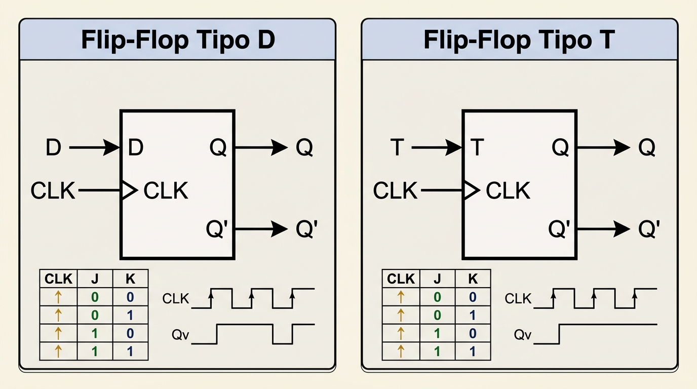
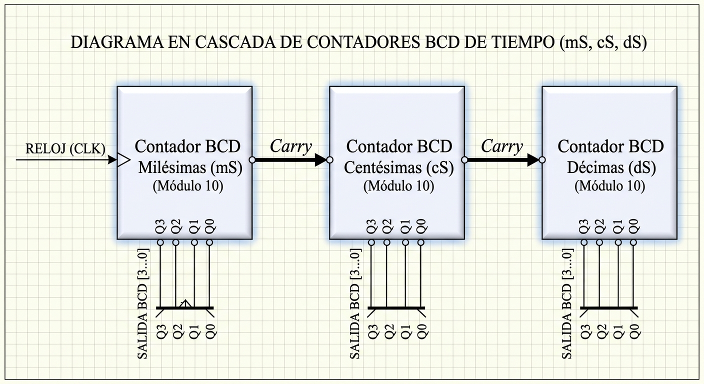

# Informe de Laboratorio: Contador Digital y Cronómetro en Display de 7 Segmentos

## Integrantes
- [Andres Mateo Arias Aguilera](https://github.com/mateoaeora124)
- [Gabriel Cangrejo](https://github.com/gabriel11cangrejo)
- [Cesar Alberto Gomez](https://github.com/Cesar7772026)

---

## 1. Introducción y Fundamentos Teóricos

El presente laboratorio aborda el diseño, la simulación y la implementación en hardware mediante Verilog HDL de un **cronómetro digital de alta precisión** multiplexado en tiempo. El sistema es capaz de realizar la medición del tiempo discriminando unidades de milésimas de segundo, centésimas de segundo, décimas de segundo y segundos enteros. 

A diferencia de los circuitos combinacionales puros desarrollados en prácticas anteriores, este sistema integra **lógica secuencial sincronizada por reloj**, permitiendo el almacenamiento de estados dinámicos, la división de frecuencias de reloj de alto rendimiento (FPGA) a frecuencias visibles y el control multiplexado de displays de 7 segmentos de ánodo común.

---

### 1.1 Lógica Secuencial y Máquinas de Estado
La **lógica secuencial** comprende el estudio y diseño de circuitos digitales cuyos estados de salida $Y(t)$ dependen no únicamente del vector de entradas actuales $X(t)$, sino también del historial o estado interno almacenado $Q(t)$:

$$Y(t) = f(X(t), Q(t))$$

$$Q(t+1) = g(X(t), Q(t))$$

En un sistema sincrónico, las transiciones de estado ocurren exclusivamente en instantes de tiempo determinados por los flancos (de subida o bajada) de una señal de reloj global ($\text{CLK}$). Esto garantiza la eliminación de condiciones de carrera (*race conditions*) y permite estructurar máquinas de estado finitas (FSM) robustas para el control numérico y temporal.

---

### 1.2 Elementos de Memoria y Registros de Almacenamiento

#### 1.2.1 Flip-Flops Base
Los Flip-Flops son las unidades biestables fundamentales capaces de almacenar $1\text{ bit}$ de información:
- **Flip-Flop Tipo D (Data):** Transfiere el valor presente en la entrada $D$ a la salida $Q$ exactamente en el flanco activo del reloj ($\text{posedge CLK}$). Es la estructura predilecta para la síntesis de contadores y registros en FPGAs.
- **Flip-Flop Tipo T (Toggle):** Conmuta el estado de su salida ($Q(t+1) = \overline{Q(t)}$) si la entrada $T=1$ al llegar el flanco de reloj.
- **Flip-Flop SR y JK:** Estructuras conmutativas que permiten operaciones de activación ($\text{Set}$), desactivación ($\text{Reset}$) y conmutación ($\text{Toggle}$), evitando el estado indeterminado del SR clásico.
---

---
#### 1.2.2 Registros de Datos y Desplazamiento
Un registro es un arreglo n-dimensional de Flip-Flops sincronizados por la misma línea de reloj. En este laboratorio, los registros de almacenamiento permiten retener las cuentas BCD (*Binary-Coded Decimal*) correspondientes a las milésimas, centésimas, décimas y segundos.

---

### 1.3 Contadores Digitales y Codificación BCD (Binary-Coded Decimal)
Un **contador digital** es un circuito secuencial estructurado por una cadena de Flip-Flops que recorre una secuencia binaria predeterminada de estados ante cada pulso de reloj.

#### Contadores Módulo N y Cascada BCD (Módulo 10)
Para representar de forma natural las fracciones de segundo y los segundos enteros en pantallas decimales, los contadores se configuran en código **BCD (Módulo 10)**, restringiendo la cuenta al rango $0 \rightarrow 9$ ($0000_2 \rightarrow 1001_2$). 

Cuando un contador alcanza su valor máximo ($N-1 = 9$), genera una señal de acarreo de salida (*Carry Out / Enable Out*) que actúa como la señal de habilitación de conteo para la siguiente etapa de mayor jerarquía:

$$\text{Frecuencia Flujo Contador Extensión} = \frac{f_{\text{Entrada}}}{10}$$
---

---
### 1.4 Divisor de Frecuencia por Contador Módulo N
Las FPGAs disponen de osciladores de cristal integrados que generan señales de reloj de alta frecuencia (por ejemplo, $50\text{ MHz}$ o $100\text{ MHz}$). Para registrar intervalos temporales precisos como $1\text{ ms}$ ($1000\text{ Hz}$), es indispensable diseñar un **divisor de frecuencia**.

Un divisor de frecuencia se implementa mediante un registro contador de paso de tamaño $k$ bits ($2^k \ge N$) con el valor límite $N$:

$$N = \frac{f_{\text{FPGA}}}{f_{\text{Deseada}}}$$

#### Ejemplo Matemático de Cómputo para $1\text{ ms}$:
Para un reloj de entrada en la FPGA de $f_{\text{FPGA}} = 50\text{ MHz}$ y una frecuencia objetivo de $f_{\text{salida}} = 1000\text{ Hz}$ ($1\text{ ms}$):

$$N = \frac{50 \times 10^6\text{ Hz}}{1000\text{ Hz}} = 50.000\text{ ciclos}$$

El contador acumula del $0$ al $49.999$. Al alcanzar $N-1$, conmuta una señal de pulso habilitador de $1$ ciclo de reloj y reinicia la cuenta a $0$, logrando una base de tiempo exacta y sin fluctuación (*jitter*) para la medición del cronómetro.

---

### 1.5 Multiplexación Temporal de Displays de 7 Segmentos
Para visualizar múltiples dígitos (milésimas, centésimas, décimas y segundos) sin utilizar una cantidad excesiva de pines de la FPGA, se utiliza la **multiplexación en el dominio del tiempo**:
1. Los buses de segmentos $seg[6:0]$ de todos los displays se conectan en paralelo a un único bus común.
2. Las líneas de selección de ánodos de cada display ($an[3:0]$) se activan de manera secuencial e individual a una frecuencia superior a $60\text{ Hz}$ (típicamente entre $100\text{ Hz}$ y $1\text{ kHz}$).
3. Gracias al efecto de la **persistencia retiniana** del ojo humano, la alternancia rápida crea la ilusión de que todos los displays están encendidos de forma continua sin parpadeo (*flicker*).
---

## 2. Código Hardware HDL en Verilog

En esta sección se presentan las implementaciones en Verilog HDL de los módulos que componen la arquitectura del cronómetro y contador digital.

### 2.1 Módulo Contador BCD de 4 Bits (`contador_bcd_4bits.v`)
Este módulo representa la unidad secuencial básica del sistema. Se encarga de realizar la cuenta en formato BCD (de `0` a `9`) sincronizada por el flanco de subida de la señal de reloj (`posedge clk`). 

Incluye un reinicio asíncrono/sincrónico mediante `rst`, una señal de habilitación de conteo (`enable`) y una salida de acarreo combinacional (`carry`) que permite encadenar múltiples dígitos en cascada (milésimas, centésimas, décimas y segundos):

```verilog
module contador_bcd_4bits (
    input clk,
    input rst,
    input enable,
    output reg [3:0] q,
    output carry
);

    always @(posedge clk) begin
        if (rst) begin
            q <= 4'b0000;
        end else if (enable) begin
            if (q == 4'd9)
                q <= 4'b0000;
            else
                q <= q + 1'b1; // Suma 1 en cada flanco cuando enable está activo
        end
    end

    // Genera acarreo al siguiente dígito únicamente al llegar a 9 y estando habilitado
    assign carry = enable && (q == 4'd9);

endmodule
```
### 2.2 Módulo Divisor de Frecuencia Configurable (`divisor_frecuencia.v`)
Este módulo parametriza la base de tiempo del sistema mediante la generación de un pulso de habilitación (*tick*) de duración igual a un ciclo de reloj. Utiliza el parámetro `SIMULATION` para escalar los divisores de frecuencia, permitiendo simulaciones rápidas en GTKWave o la síntesis exacta en FPGA sobre un oscilador base de $25\text{ MHz}$.

A través del bus de selección `sel[1:0]`, el usuario o el sistema puede ajustar dinámicamente la velocidad del tiempo (escalas de $1\text{ ms}$, $10\text{ ms}$, $100\text{ ms}$ y $1\text{ s}$ en hardware real):

```verilog
module divisor_frecuencia #(
    parameter SIMULATION = 1
)(
    input clk,
    input rst,
    input [1:0] sel,
    output reg tick
);

    integer counter;
    integer N;

    // Asignación del valor N según sel y el modo de simulación
    always @(*) begin
        if (SIMULATION) begin
            case (sel)
                2'b00: N = 6;       // Modo rápido para simulación GTKWave
                2'b01: N = 10;
                2'b10: N = 20;
                2'b11: N = 50;
                default: N = 6;
            endcase
        end else begin
            case (sel)
                2'b00: N = 25_000;      // 1 ms a 25 MHz
                2'b01: N = 250_000;     // 10 ms
                2'b10: N = 2_500_000;   // 100 ms
                2'b11: N = 25_000_000;  // 1 s
                default: N = 25_000;
            endcase
        end
    end

    // Generación del pulso de 1 solo ciclo de reloj
    always @(posedge clk or posedge rst) begin
        if (rst) begin
            counter <= 0;
            tick    <= 0;
        end else begin
            if (counter >= N - 1) begin
                counter <= 0;
                tick    <= 1; // Pulso de 1 solo ciclo de reloj cuando se alcanza N-1
            end else begin
                counter <= counter + 1;
                tick    <= 0; // Se mantiene en 0 durante el resto del conteo
            end
        end
    end

endmodule
```
